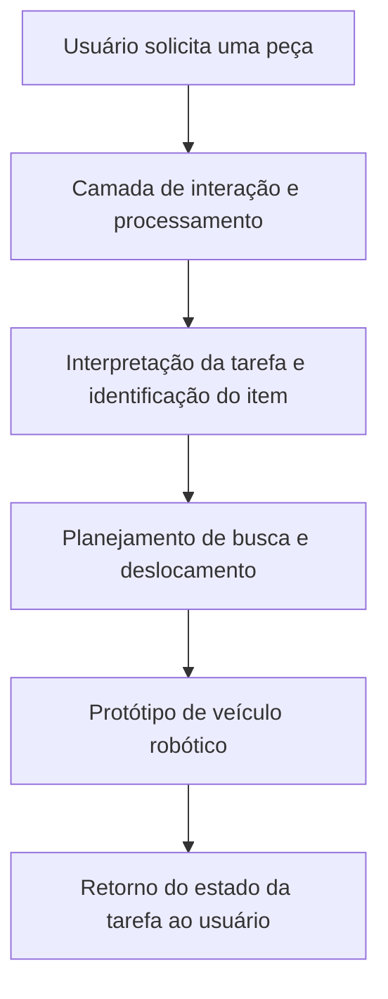

<div align="center">

# Alfred Project

### Robótica autônoma e inteligência artificial para operações de almoxarifado

**Protótipo acadêmico desenvolvido no Inteli a partir de um desafio operacional relacionado à Cervejaria Ambev.**

[**Documentação técnica**](https://2023m8t2-inteli.github.io/andevs/docs/intro) · [**Código-fonte**](./src) · [**Documentos do projeto**](./docs) · [**Projeto original**](https://github.com/2023M8T2-Inteli/andevs)

</div>

---

## Visão geral

O **Andevs — Alfred Project** investiga como robótica e inteligência artificial podem apoiar tarefas de movimentação e localização de peças em um almoxarifado industrial.

O desafio apresentado no projeto consiste em **desenvolver um protótipo de veículo robótico autônomo** que receba uma solicitação do usuário e realize a busca de uma peça. A proposta busca simplificar etapas da rotina de separação de materiais e investigar oportunidades para reduzir o tempo de atendimento e os erros operacionais.

Este repositório reúne **código-fonte e documentação de desenvolvimento** do projeto realizado no **Inteli — Instituto de Tecnologia e Liderança**, no contexto de um desafio associado à **Cervejaria Ambev**.

> **Estado do projeto:** protótipo acadêmico (2023). Os ganhos operacionais apresentados como objetivos **não devem ser interpretados como resultados comprovados em operação industrial**. A existência de integração em produção, precisão dos modelos e desempenho do robô depende de evidências e testes específicos.

## O problema

Em operações industriais, a localização e a separação de peças de reposição podem envolver deslocamentos, consultas de estoque e atividades manuais. Dependendo do fluxo da operação, isso pode comprometer a agilidade de atendimento das solicitações.

O projeto investiga a possibilidade de empregar um robô para auxiliar esse processo, com foco em:

- **Apoio à localização de peças:** associar uma solicitação a um item a ser encontrado no ambiente.
- **Automação do deslocamento:** explorar a movimentação de um veículo robótico em um cenário de almoxarifado.
- **Integração entre software e sistemas físicos:** conectar a experiência do usuário ao comportamento esperado do protótipo.
- **Potencial de eficiência:** avaliar, mediante testes, oportunidades de reduzir tempo de separação e falhas operacionais.

As metas acima descrevem a **motivação e o escopo pretendido**, não indicadores de desempenho já medidos.

## Proposta de solução

A ideia central do **Alfred** é transformar uma solicitação de peça em uma tarefa que possa ser atendida por um sistema robótico. A concepção envolve a interação do usuário, o processamento da requisição e a execução da tarefa pelo veículo.

### Fluxo funcional — visão conceitual



> **Importante:** o diagrama sintetiza a **proposta funcional** descrita na apresentação original. Ele não certifica que todas as etapas estejam implementadas, integradas ou validadas no código. Consulte o diretório [`src/`](./src) e a [documentação](https://2023m8t2-inteli.github.io/andevs/docs/intro) para verificar os módulos e experimentos efetivamente desenvolvidos.

## Escopo técnico

| Frente | Papel na proposta | Evidência disponível |
| --- | --- | --- |
| Robótica móvel | Investigar a utilização de um veículo para buscar peças | Objetivo declarado no README original e documentação do projeto |
| Inteligência artificial | Explorar o processamento de solicitações direcionadas ao robô | Objetivo declarado no README original; implementação específica exige inspeção dos módulos |
| Software de aplicação | Viabilizar a interação entre usuário e componentes técnicos | Arquivos de código-fonte disponíveis em [`src/`](./src) |
| Automação de almoxarifado | Estudar a aplicação da solução à separação de materiais | Problema industrial apresentado pelo projeto |
| Engenharia e documentação | Registrar a evolução do protótipo e suas decisões | Documentação e histórico de desenvolvimento disponíveis no repositório |

**Nota sobre visão computacional:** embora o nome deste repositório contenha `cv-ai`, a página principal original não informa quais modelos, bibliotecas de visão computacional ou métricas foram utilizados. Por isso, este README **não atribui algoritmos ou capacidades de percepção específicos** sem validação adicional no código e nos documentos.

## Tecnologias e artefatos

A análise da composição de linguagens exibida pelo GitHub indica a presença de:

- **Python:** linguagem predominante no código do projeto.
- **Shell e PowerShell:** scripts de suporte e execução.
- **JavaScript, HTML e CSS:** componentes de aplicação e interface.
- **GitHub Actions:** diretório de fluxos de trabalho para automação de tarefas do repositório.

A presença desses arquivos **não garante**, por si só, que os respectivos serviços estejam ativos ou que todos os componentes possam ser executados isoladamente. Versões de bibliotecas, requisitos de hardware, modelos de IA e dependências devem ser confirmados nos módulos correspondentes.

## Estrutura do repositório

```text
ambev-industrial-automation-cv-ai/
├── .github/
│   └── workflows/     # Fluxos de automação do repositório
├── .vscode/           # Configurações de desenvolvimento
├── docs/              # Documentação e artefatos do projeto
├── src/               # Implementação e código-fonte
├── .gitignore
└── README.md
```

**Pontos de entrada:**

- [`src/`](./src) — explore a implementação do protótipo e seus módulos.
- [`docs/`](./docs) — consulte os documentos técnicos e os registros de desenvolvimento.
- [Documentação publicada](https://2023m8t2-inteli.github.io/andevs/docs/intro) — leia a apresentação e as versões disponibilizadas pela equipe.
- [Repositório da equipe](https://github.com/2023M8T2-Inteli/andevs) — acesse a origem acadêmica do projeto.

## Como explorar e reproduzir

### 1. Obter o código

```bash
git clone https://github.com/JacksonAguiar/ambev-industrial-automation-cv-ai.git
cd ambev-industrial-automation-cv-ai
```

### 2. Consultar o ambiente necessário

Comece pela [documentação publicada](https://2023m8t2-inteli.github.io/andevs/docs/intro), pelos documentos em [`docs/`](./docs) e pelos arquivos de configuração presentes em [`src/`](./src).

**Atenção:** a reprodução integral pode exigir hardware robótico, dispositivos externos, dependências, configurações de rede e serviços específicos. A página inicial consultada não apresenta um comando único, verificado, para iniciar todo o sistema. Por essa razão, não são fornecidos comandos fictícios de instalação ou execução.

### 3. Executar o componente de interesse

Siga as instruções e os requisitos do módulo correspondente. Em atividades com robôs físicos, realize primeiro as verificações de segurança e os testes de bancada previstos para o ambiente utilizado.

## Validação e resultados

A proposta apresenta uma **hipótese de melhoria operacional**: o emprego de automação robótica pode contribuir para processos de separação de peças. Para avaliar essa hipótese de forma rigorosa, recomenda-se registrar resultados reproduzíveis para indicadores como:

| Indicador a avaliar | Pergunta de validação |
| --- | --- |
| Tempo por solicitação | Quanto tempo decorre entre o pedido da peça e o encerramento da tarefa? |
| Sucesso da tarefa | Em quantas tentativas o protótipo conclui o fluxo proposto? |
| Identificação de itens | Qual é a taxa de acerto na identificação da peça solicitada, se aplicável? |
| Navegação | Como o robô se comporta diante de obstáculos e mudanças no ambiente? |
| Segurança operacional | Quais mecanismos e procedimentos minimizam riscos durante o deslocamento? |
| Robustez | O comportamento é consistente em diferentes condições de teste? |

**Métricas quantitativas verificadas:** não foram identificadas na página inicial do repositório analisada para esta revisão. Não se afirma, portanto, que houve redução mensurada de tempo, diminuição comprovada de erros ou implantação em ambiente industrial real. Caso esses resultados estejam nos relatórios técnicos, devem ser citados com seus cenários, métodos e condições de teste.

## Limitações e próximos passos

Este trabalho tem natureza **acadêmica e experimental**. Para evoluir a documentação e sustentar afirmações sobre desempenho, seria útil:

1. Publicar um inventário dos módulos implementados, indicando o que foi testado em simulação e em hardware.
2. Documentar o ambiente de execução, com versões, dependências e periféricos necessários.
3. Disponibilizar uma demonstração em vídeo ou imagens representativas de testes reais, com contexto.
4. Apresentar resultados quantitativos e a metodologia usada para coletá-los.
5. Explicitar requisitos de segurança, limitações do ambiente e falhas conhecidas.

Esses itens são **recomendações de documentação e evolução**, não funcionalidades declaradas como já concluídas.

## Contexto acadêmico e créditos

Projeto de **2023**, desenvolvido no **Inteli — Instituto de Tecnologia e Liderança**, a partir de um problema de operação de almoxarifado relacionado à **Ambev**, sob a identidade **Andevs — Alfred Project**.

**Orientação:** [Murilo Zanini de Carvalho](https://www.linkedin.com/in/murilo-zanini-de-carvalho-0980415b/).

A autoria coletiva e o histórico das contribuições podem ser consultados em [Contributors](https://github.com/JacksonAguiar/ambev-industrial-automation-cv-ai/graphs/contributors) e no [repositório original](https://github.com/2023M8T2-Inteli/andevs). Os créditos institucionais aqui registrados não constituem declaração de endosso comercial ou de implantação da solução pela Ambev.

## Licenciamento

O README original menciona a licença [Creative Commons Attribution 4.0 International (CC BY 4.0)](https://creativecommons.org/licenses/by/4.0/). **Antes de reutilizar o código ou distribuir derivados, confirme o escopo dessa licença e a existência dos instrumentos jurídicos aplicáveis no projeto original.** A menção no README não substitui um arquivo de licença completo e inequívoco para o código.

---

<div align="center">

** Alfred Project**  
Robótica e IA aplicadas a desafios reais de operações industriais.

[Documentação](https://2023m8t2-inteli.github.io/andevs/docs/intro) · [Código](./src) · [Histórico de contribuições](https://github.com/JacksonAguiar/ambev-industrial-automation-cv-ai/graphs/contributors)

</div>
